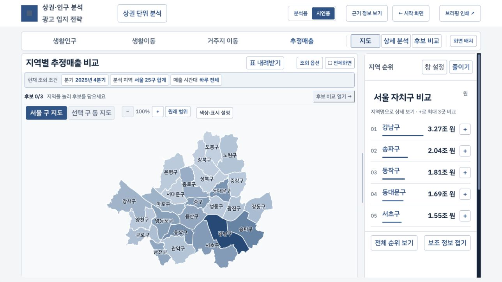

# 자료 메뉴와 기능 버튼 통합

2026-11-16 · 구조 소스 d204a45 / 선택색 후속 1374062 · 적용: 생활인구·생활이동·거주지 이동·추정매출의 분석/시연 지도·추이·후보 화면.

사용자가 지적한 중복 제목 행을 없애고 자료 선택, 보기 전환, 조회 조건·보조 화면 복귀·화면 배치 버튼을 한 줄에 모았다. 선택 자료는 진한 파란 글자와 굵기로 강조한다. 큰 색상 블록은 제거했다. 화면 제목은 보조기기용 h1으로 남겨 접근성을 유지한다.

공통 헤더와 자료 메뉴를 고정하되 실제 헤더 높이를 측정해 겹침을 방지한다. 본문 이동 여백도 같은 기준을 쓴다. 시연 본문의 높이는 실제 상단 영역이 차지한 만큼을 제외해 계산한다. 1000px 이하에서는 내용 잘림을 피하기 위해 두 줄 배치를 허용한다. 상권 전용 화면의 목적이 다른 메뉴 구조는 변경하지 않았다.

검증:

- 로컬4자료×지도/상세/후보×분석/시연=24여정. 기존 후보 담기와 상세 이동도 함께 실행.
- 1366×768에서 일반·보조 분석 상단높이51px, 가로 넘침 없음. 조회 조건창 한 개, 추이 복귀 확인.
- 분석용 문서 스크롤1581px 상태에서 공통 헤더top0, 자료 메뉴top74px로 고정 확인. 화면 배치 창도 가시 영역 안에 열림.
- 빌드와 기존 단위 검사70개 통과. 계산·원자료는 변경하지 않았음.

공개 구조 점검: Pages68953ace1c97cc00a3f90eb498ddd57470cfbc37에서 분석12·시연12개 여정 통과. 스크롤874.5px에서 헤더top0·메뉴top74 고정 확인. 보조 화면1001px 폭에서 한 줄·가로넘침 없음.

선택 탭에 마우스를 올리면 남아 있던 기존 배경 강조도1374062에서 제거했다. 구조와 자료 계산은 그대로이며 최종 선택·hover·focus 색은 별도 공개 확인한다. 최종 Pages a91bec8f4e49e7865fce8eb4beb45e8d1d167c83. 최종 공개 실행 결과와 화면은 [증거 폴더](evidence/compact-toolbar/)에 별도 저장한다. 이 문서는 이전52개계열 전수방문 결과를 새 버전의 모든 기능 통과로 소급하지 않는다.

최종 공개 실행: 1374062 / index-Cz8rjj3y.js / 실행43801634285 성공. 두 모드×4자료의 선택 탭을 실제 클릭하여 hover 상태에서도 투명 배경·진한 파랑 글자·선택 상태를 확인했다. 키보드 Enter 재선택, 상세 이동, 화면 배치 창의 화면 내 표시도 확인했다. 마지막 색상 변경 후 전체24여정을 다시 수행한 것으로 주장하지 않으며, 구조24여정은d204a45, 최종8색상 문맥은1374062로 증거를 분리했다.

