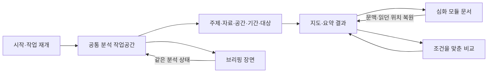

# 확장형 분석 대시보드 IA·화면 관리·정보 전개 검토

2026-11-16 · **확장 방향 참고안 / 새 IA 구현 전**. 현재 소스·배포 화면, 독립 Codex 검토, 공개 데모와 공식 문서를 대조했다. 사용성 효과를 실사용자 실험으로 검증한 보고서는 아니다. 이후 사용자 지시로 우선순위는 [디자인·사용성 단계별 설계 v2](expansion-workspace-design.md)로 갱신했다. 새 IA를 먼저 적용하는 순서로 사용하지 않는다.

## 1. 우선 판단

문제의 중심은 색·글자·창 크기보다 **분석 목적, 자료, 공간 단위, 결과 보기, 사용 모드가 서로 다른 메뉴 층에 섞여 있는 것**이다. 자료가 늘 때마다 상단 탭과 별도 진입 버튼을 늘리는 방식은 유지하기 어렵다.

권고하는 대원칙은 다음과 같다.

1. 시작은 작업 선택 허브, 공간 탐색은 고정 작업공간, 심화는 규격화된 분석 모듈 문서, 시연은 한 근거씩 보여 주는 장면으로 구분한다.
2. 내용·도표는 자료 특성에 맞춰 달라지되, 조회·선택·확장·이동·복귀의 의미는 공통 규칙을 따른다.
3. 공통 화면 틀과 자료별 정보 전개를 분리한다. 같은 화면 틀을 쓴다고 모든 자료에 같은 퍼널·도표·순서를 강제하지 않는다.

## 2. 현재 화면에서 확인한 비효율

| 사용자가 하려는 일 | 현재 문제 | 확장 시 위험 | 방향 |
|---|---|---|---|
| 상권 입지를 검토 | 시작의 ‘상권 추정매출’은 구/동 집계, 상단 ‘상권 단위 분석’은 별도 작업공간 | 상권·역·부동산이 자료명인지 공간 단위인지 다시 배워야 함 | 목적별 진입 후 자료·공간 단위를 분리 |
| 분석과 발표를 오감 | 일반 분석은 자료×보기×모드, 상권은 별도 화면과 추이 창 | ‘상세’와 ‘이전’의 의미가 화면마다 달라짐 | 공통 작업 문맥에 결과 보기·발표 표현을 연결 |
| 조건을 바꾸고 결과 확인 | 조회 조건·색상·축·배치·창 설정의 진입점이 여러 곳 | 어떤 결과까지 바뀌는지 예측하기 어려움 | 적용 범위가 보이는 조회, 표시, 배치의 분리 |
| 지도 공간을 조절 | 일반 화면은 비율·옵션 폭·지도 높이·순위 표시, 상권은 패널 픽셀·개별 창 도킹 | 같은 목적을 다른 방식으로 배워야 하고 수동 조절 부담이 큼 | 공통 기본 배치와 고급 조절의 우선순위 분리 |
| 상세에서 복귀·재방문 | 최근 상권 왕복은 보완됐으나 주소에 분석 문맥이 담기지 않음 | 역/상권/부동산을 오가며 상태가 갈라지고 새로고침·공유가 취약 | 문맥·주소·복귀 계약을 먼저 정의 |
| 자료·기간이 늘어남 | 고정 자료4종과 개별 날짜/분기/연도 선택, 영역별 별도 상태 | 긴 목록·미지원 조합·숨겨진 화면의 불필요한 로딩 | 자료별 지원 설명서와 필요한 자료만 조회 |

근거: `src/Hero.tsx`의 고정 자료 목록, `src/main.tsx`의 `view/mode/tab/presentationStep` 및 별도 상권 진입, `src/MarketExplorer.tsx`의 독립 조건·후보·추이, `src/LayoutControls.tsx`와 `src/MapWorkspace.tsx`의 서로 다른 배치 체계. 배포 화면의 시작·일반 조회·화면 배치도 실제로 열어 확인했다.

현재 장점인 실제 조건 칩, 지도 선택과 정보 연동, 접힌 범례, 같은 자료의 분석/시연 계산 재사용은 보존한다. 최근 기능 수정이 메뉴·읽기 모델 전체의 통일을 의미하지는 않는다.

## 3. 벤치마킹: 가져올 규칙과 가져오지 않을 것

| 참고 | 확인 범위 | 가져올 점 | 그대로 가져오지 않을 점 |
|---|---|---|---|
| [Kepler.gl](https://docs.kepler.gl/docs/user-guides) | 공개 데모의 자료 추가·샘플 선택·지도 주변 도구, 공식 가이드 | 데이터·레이어·필터·표현/상호작용을 나누고 지도 캔버스를 유지 | 전문가용 아이콘 위주 메뉴·많은 조절을 광고주 브리핑 기본으로 노출 |
| [Metabase 필터](https://www.metabase.com/docs/latest/dashboards/filters) | 공식 화면 이미지와 범위 규칙 | 전체·섹션·개별 도표의 조건 범위를 구분, 관련 결과에 연결된 조건만 노출 | 비교를 위한 모든 도표를 한 긴 화면에 상시 나열 |
| [Power BI 상세 이동](https://learn.microsoft.com/en-us/power-bi/create-reports/desktop-drillthrough) | 공식 동작 계약 | 선택 대상·조회 문맥을 상세에 전달하고 복귀를 명시 | ‘상세’라는 한 이름으로 선택·확대·이동을 혼용 |
| [Tableau 펼침/숨김](https://help.tableau.com/current/pro/desktop/en-gb/dashboards_create.htm) | 공식 화면 구성 설명 | 부차적 도구는 필요할 때 열고 이동 목적을 이름에 표시 | 모든 정보를 떠 있는 창으로 만드는 구성 |

제품 전체를 실사용해 비교한 순위가 아니다. Kepler 샘플 데이터 로딩 이후의 전체 분석 여정까지 통과했다고 주장하지 않는다. 각 문서·화면에서 확인한 관리 패턴을 이 서비스의 목적에 맞춰 선택했다.

## 4. 읽기·인포그래픽·심화·복귀의 휴리스틱

읽기는 하나의 고정된 시선 경로가 아니다. [NN/G의 읽기 연구](https://www.nngroup.com/articles/f-shaped-pattern-reading-web-content/?LanguageId=1)는 F형 외에도 다양한 탐색을 설명한다. 이를 모든 한글 대시보드를 F자나 Z자로 배치하라는 지침으로 사용하지 않는다.

| 과업 | 적용 원칙 | 화면 규칙 | 검사 질문 |
|---|---|---|---|
| 문장을 훑어 목적 파악 | 명확한 정보 위계·앞부분의 정보 단서 | 질문형/결과 범위 제목, 짧은 핵심 요약, 관련 문장 묶기 | 제목만 보고 무엇을 판단하는 화면인지 말할 수 있나? |
| 수치·도표 읽기 | 전체 파악 후 좁혀 보기 | 공간 분포·비교 기준 → 선택 → 상세, 값·단위·시점 가까이 표시 | 같은 색·숫자가 어떤 단위와 조건인지 바로 아는가? |
| 변화·차이 판단 | 비교 가능한 표현·외부 기억 단서 | 같은 축·눈금·정의, 기준값/선택값/증감, 선택 강조 연동 | 차이를 기억해서 비교하지 않고 화면에서 대조할 수 있나? |
| 파생 정보 발견 | 점진적 공개와 명확한 이동 단서 | 주분석 먼저, 선택적 모듈은 목적·요약·진입 이름 제공 | 누르기 전에 나올 내용과 적용 범위를 예상하는가? |
| 세부를 읽는 동안 맥락 유지 | 기억보다 재인 | 대상·조건 요약·부모 경로를 남김 | 지금 대상·자료·조건·위치를 다시 찾지 않고 설명하는가? |
| 접기·확대·복귀 | 사용자 통제·가역성 | 서로 다른 이름, 조건·선택·카메라·읽던 위치 복원 | 되돌아온 뒤 같은 조건을 다시 입력할 필요가 없는가? |
| 한계와 미지원 이해 | 상태의 가시성·오류 예방 | 결측≠0, 미지원 조합·기간 차이를 결과 가까이 표시 | 자료가 없는 것과 0인 것을 구분하는가? |

근거는 [Shneiderman의 정보 탐색 과업](https://www.cs.umd.edu/users/ben/papers/Shneiderman1996eyes.pdf), [점진적 공개](https://www.nngroup.com/articles/progressive-disclosure/), [재인과 회상](https://www.nngroup.com/articles/recognition-and-recall/), [사용자의 동작 기대와 뒤로 가기](https://www.nngroup.com/articles/mental-models/)다. 방향·비율·모듈 개수 자체를 이 자료들이 지정한 보편 법칙으로 주장하지 않는다.

## 5. 화면 운영 정책

| 화면 유형 | 주목적 | 스크롤 | 확장 원칙 |
|---|---|---|---|
| 시작 허브 | 작업 선택·재개·자료 찾기 | 필요한 범위의 페이지 스크롤 | 긴 마케팅형 설명보다 목적별 진입과 재개 우선 |
| 지도/요약 작업공간 | 분포 탐색·선택·조건 조정 | 바깥 페이지 고정, 조건/상세 패널만 스크롤 | 지도를 유지하고 부정보를 열기 |
| 심화 분석 문서 | 하나의 질문을 여러 근거로 읽기 | 페이지 스크롤 하나가 기본 | 규격화된 모듈을 아래로 펼침, 긴 표만 내부 스크롤 예외 |
| 브리핑 | 광고주에게 한 근거와 의미 전달 | 한 장면은 한 화면, 장면 전환 | 부가 분석은 요청 시 열고 원래 장면 복귀 |

작업공간과 심화 문서는 같은 페이지에서 조용히 바뀌는 모드가 아니라 사용자가 목적과 경로를 알 수 있는 보기로 구분한다. 세로 읽기에서 모듈 목차는 ‘목차’로 표시하고, 서로 다른 화면의 ‘탭’과 혼동하지 않는다.

### 확장 위치의 역할

| 위치 | 기본 용도 | 피할 것 |
|---|---|---|
| 왼쪽 | 조회 조건·분석 선택. 두 맥락을 구분 | 자료 찾기 메뉴와 세부 조건을 한 긴 창에 혼합 |
| 오른쪽 | 지금 선택한 대상의 정보·관련 행동 | 전체 분석 보고서를 좁은 창에 넣기 |
| 상단 | 현재 경로·짧은 적용 조건·주요 행동 | 긴 옵션·설명으로 지도를 아래로 밀기 |
| 하단/본문 안 | 같은 질문의 추가 근거·관련 모듈 | 자료를 모두 자동 펼쳐 긴 페이지 만들기 |
| 툴팁/팝오버 | 짧은 의미·정확값·한두 선택 | 판단에 필수인 경고를 마우스 오버에만 숨기기 |
| 확대 보기 | 같은 도표를 크게 읽기 | 새 분석 대상이나 조건으로 몰래 바꾸기 |
| 별도 상세 화면 | 다른 질문·대상으로 깊이 이동 | 복귀 문맥 없는 새 창·팝업 중첩 |

이 위치 배정은 우리 제품의 일관성 규칙이다. 작은 화면에서는 같은 역할을 서랍/전체 보기로 옮겨도 조작 의미와 상태는 유지한다. 기본 배치는 고정·예측 가능하게, 이동·자석·투명도는 고급 배치 설정으로 제공한다.

### 행동 이름과 복귀 계약

- **펼치기/접기:** 같은 모듈의 상세를 보이거나 숨긴다. 조회값은 바꾸지 않는다. 제목·핵심 요약은 남긴다.
- **크게 보기/확대 닫기:** 같은 도표를 큰 공간에 표시한다. 닫으면 해당 모듈의 위치·선택으로 복귀한다.
- **상세 분석/돌아가기:** 다른 분석 보기로 이동한다. 선택 대상·공통 조건·출발 모듈과 읽던 위치를 전달한다.
- **조건 변경:** 어느 결과에 적용되는지 명시한다. 모듈의 국소 조건은 ‘이 모듈만’ 표시하고 초기화도 그 범위에만 적용한다.
- **닫기:** 임시 창을 닫는다. 조건 초기화와 구분한다. **이전 방문 화면**과 **상위 지도**도 다른 동작이다.
- 사용자가 연 부가 모듈을 다른 모듈을 열었다는 이유로 예고 없이 접지 않는다. 기본은 주모듈만 펼침이며 사용자가 추가 공개를 선택한다.
- 상세 이동·복귀는 주소·브라우저 뒤로 가기와 일치시키고, 색상·창 위치 같은 개인 표현 설정은 분석 조건과 분리한다. 숨긴 모듈의 재생·키보드 초점·떠 있는 옵션이 앞 화면에 남지 않게 한다.

## 6. 분할·비교 화면의 표준 양식

| 양식 | 사용 질문 | 크기·정렬 기준 |
|---|---|---|
| 집중형 | 한 지도/그래프의 패턴 | 남은 주영역 전체 사용 |
| 주정보+보조형 | 지도와 선택 근거/순위 | 현행 PC 기본75:25를 출발점으로 조절, 보조 최소 폭·지도 최소 공간 유지 |
| 두 대상/두 시점 비교 | A와 B의 차이 | 도표 영역50:50, 같은 높이·여백·제목 기준선, 공통 조건은 한 번 |
| 후보3곳 비교 | 동일 조건의 후보 선택 | 같은 너비·구조·단위·높이, 현행 최대3곳 유지 |
| 반복 소도표 | 같은 정의의 시간/집단 패턴 | 정해진 행·열과 공통 눈금, 화면이 작으면 같은 크기로 세로 재배치 |

높이는 주화면의 가용 높이 또는 모듈의 ‘기본/확대’ 규격으로 제한한다. 같은 비교 행의 긴 제목 때문에 한 그래프만 작아지지 않게 제목 높이와 실제 도표 높이를 분리한다. 구체적인 모듈 픽셀 규격은 PC·태블릿·모바일 시안에서 읽기 검증 후 확정한다.

비교는 모양뿐 아니라 의미도 맞춰야 한다. 같은 지역의 두 시점 지도는 범위·확대·색상 눈금을 연동한다. 다른 지역 비교는 축척·색상·집계 정의 차이를 알린다. 절대값 비교와 기준100 지수 비교를 구분하고, 같은 단위라도 조사기간·모집단이 다르면 동등 비교로 표시하지 않는다. 작은 화면은 글자를 줄여 두 도표를 억지로 넣지 않고 세로 카드나 명시적인 A/B 보기를 사용한다.

## 7. 자료별 정보 스토리

| 자료 | 판단 질문 | 기본 전개 | 주의 |
|---|---|---|---|
| 생활인구 | 누가 언제 머무는가? | 공간 분포 → 시간 변화 → 대상 구성 → 후보/시간 비교 | 체류 추계≠고유 방문객·광고 도달 |
| 생활이동 | 어디서 언제 들어오고 나가는가? | 방향·시각 기준 → 도착/출발 분포 → 상대 지역 → 시간 변화 | 이동 건수≠거주지 전출입 |
| 거주지 전입·전출 | 생활 기반이 장기적으로 어떻게 바뀌는가? | 전입·전출 규모 → 순이동 → 집단 구성 → 여러 해 추세 | 순이동은0선과 부호, 경계 변경·결측 유지 |
| 상권 매출·유동 | 어느 상권·업종·시간을 검토할까? | 지역/상권 규모 → 매출의 업종 구성 또는 유동의 제공 집단·시간 구성 → 분기 변화 → 같은 조건 후보 비교 | 시기가 다른 인구·매출을 전환율로 계산하지 않음; 성별·연령·시간의 개별 제공이 교차집계 지원을 뜻하지 않음 |
| 지하철역(추가 시) | 어느 역·방향·시간에 이동 수요가 있는가? | 역/노선 분포 → 승하차·시간 → 요일 특성 → 주변 입지 | 승하차·환승·출입구 자료의 제공 단위 구분 |
| 부동산(추가 시) | 어떤 입지·상품의 가격·공급이 변하는가? | 공간·상품 범위 → 가격/거래량 → 기간 변화 → 비교 근거 | 표본 수·면적 단위·거래 시차·상품 구성 차이 |

마지막 두 항목은 데이터 확보 전의 설계 가정이다. 메뉴만 활성화하거나 예시값을 실제값처럼 보여 주지 않는다. ‘인사이트’ 문장은 관측된 사실·가능한 해석·다음 검토를 구분하고 인과나 광고 효과를 만들어 내지 않는다.

각 모듈은 **판단 질문 / 적용 조건 / 핵심 결과 / 도표 / 해석·한계 / 다음 행동**의 공통 계약을 가진다. 긴 설명은 세로 읽기에서 구조화하되 단위·비교 기준·결측 경고는 결과에서 숨기지 않는다.

### 지도 외 인포그래픽 선택 규칙

도표는 **판단 질문 → 자료 구조·제공 단위 → 비교 기준 → 표현 방식** 순으로 고른다. 같은 자료라도 규모를 비교하는 화면과 변화에 집중하는 화면은 다르게 구성한다. [Tableau의 차트 선택 안내](https://help.tableau.com/current/pro/desktop/en-us/what_chart_example.htm)를 참고하되 다음은 이 제품의 제안 규칙이다.

| 보여 줄 내용 | 우선 표현 | 데이터·해석 조건 |
|---|---|---|
| 기간에 따른 추이 | 선 그래프, 필요시 증감 보조 도표 | 실제 시간 간격 유지, 결측 구간 연결 금지, 분기 자료를 시간별 값으로 만들지 않음 |
| 지역·상권·업종 규모와 순위 | 정렬 가로 막대 | 길이 비교의 기준은0, 전체/상위 일부 범위를 명시 |
| 전입·전출과 순이동 | 전입·전출 나란한 막대 + 순이동 발산 막대 | 순이동은0 중심, 전입과 전출 규모도 함께 확인 가능 |
| 성별·연령·업종 구성 | 비율 막대 또는100% 누적 막대 | 동일 모집단의 중복 없는 부분만 합산, 인원/비율 전환과 분모 표시 |
| 요일×시간 특성 | 열지도와 선택 구간 상세 | 일별·시간별 원자료 또는 제공된 요일×시간 교차집계 사용, 독립 요일·시간 합계로 교차값을 만들지 않음; 제공 범위·관측일 수·누락 표시 |
| 값의 분포·편차 | 히스토그램·상자 그림 | 원자료의 관측 단위를 명시, 지역 집계값 분포를 개인 분포로 해석하지 않음 |
| 두 지표의 관계 | 산점도 | 기간·공간 집계·연결 기준 정합, 각 축의 단위 명시(서로 다른 단위 가능), 상관을 원인으로 서술하지 않음 |
| 출발지·도착지 흐름 | 상대 지역 순위, 필요시 흐름 도표 | 같은 이동 집계와 방향 기준, 기타 지역·누락 처리; 모든 연결선을 기본 노출하지 않음 |

추이의 실제값 축은 필요시 관측 범위로 좁힐 수 있지만 축 절단을 알린다. 기준100 지수는100 기준선과 편차에 여유를 둔 눈금을 쓴다. 서로 비교하는 도표는 공통 눈금이 기본이며 별도 눈금 사용은 명시한다.

설명은 모든 수치를 반복하는 문장 대신 **무엇이 달라졌는지 / 비교 기준은 무엇인지 / 다음에 무엇을 볼지**를 전달한다. 정확한 수치·출처·자료 한계는 툴팁·상세 표로 보완하되 해석에 필수적인 단위·분모·미지원·결측은 숨기지 않는다. 도표 종류는 달라도 앞 절의 집중형·비교형·모듈 규격과 복귀 규칙을 공유한다.

복귀 시 경로·지도 카메라·읽던 위치를 복원하되, 상세에서 사용자가 의도적으로 바꾼 공통 조회 조건은 유지한다. 모듈 안에서만 쓰는 비교 기준·축 설정은 해당 모듈에 한정한다. ‘이전 조건으로 되돌리기’는 일반 복귀와 구분하는 별도 동작으로 설계한다.

## 8. 확장 가능한 기본 IA

전역 메뉴는 **시작 / 분석 / 브리핑**처럼 안정된 작업 단위로 유지하고, 자료 안내·근거는 보조 진입으로 둔다. 주제나 데이터가 늘 때마다 전역 메뉴를 하나씩 추가하지 않는다.

시작의 우선 작업은 현재 목적에 맞춰 **상권 입지 검토 / 구·동 인구 검토**다. 향후 교통·부동산은 분석 주제 목록을 확장한다. 한 자료가 여러 목적에 재사용될 수 있으므로 주제와 자료 보관함을 같은 트리로 만들지 않는다.

작업공간은 왼쪽 조회, 중앙 결과, 오른쪽 선택 정보의 공통 틀을 사용한다. ‘메뉴·조건’은 분석을 찾는 탐색과 현재 결과를 좁히는 조건을 분명히 나눈다. 현재 조건 칩은 기존 입력을 여는 진입점이며 같은 선택창을 복제하지 않는다.

역은 행정동의 필연적인 하위 단위가 아니며, 부동산·상권·행정구역 경계도 같은 트리가 아니다. 행정구역 탐색, 역/노선 탐색, 상권 탐색은 각자의 관계를 쓰고 교차 분석에는 범위·연결 기준을 명시한다.

수평 확장은 새 주제·지표·공간 객체를 ‘자료 설명서’에 추가하는 구조, 수직 확장은 같은 분석 문맥에 심화 모듈·기간 범위·집단 상세를 붙이는 구조로 나눈다. 설명서에는 제공 공간 단위·시계열 주기·지원 조건 조합·단위·결측·연결 기준·가능한 보기·출처를 둔다. 양이 늘면 필요한 자료 범위와 열린 모듈만 불러오는 구조로 옮기되, 지금 백엔드 전면 도입을 선행 조건으로 삼지 않는다.

## 9. 다음 설계·검증 순서

1. 최신 단계별 설계의 G0–G3에 따라 현행 화면의 불만·계약·전후 시안을 정리하고 공간·가독성·동작을 함께 개선한다. 작업·조회와 시연·결론의 두 시나리오는 각 단계에서 따로 검증한다.
2. 국소 개선으로 풀리지 않는 메뉴·경로 문제가 확인된 경우에만 G4에서 이 문서의 확장 IA 대안을 검토한다. 지하철·부동산 빈 틀이나 새 허브가 현재 불편 개선의 선행 조건은 아니다.
3. 실제 사용자 과업으로 목적 발견, 조건 해석, 값 비교, 심화 발견, 복귀, 작업 재개를 검사한다. 완료율·오류/오해·재입력·탐색 시간·도움 요청을 기록한다. 클릭 수만 줄었다고 효과적이라고 판단하지 않는다.

이후 E2E는 버튼 반응뿐 아니라 조건 범위, 선택 대상, 비교 의미, 스크롤/카메라/초점 복원, 숨긴 창의 잔존, 자료 미지원 복구를 검사한다. 현재 제안의 효과는 아직 검증 전이며, 새 IA를 실제 화면에 적용하지 않았다.

## 10. 변경 영향 및 현재 범위

| 영역 | 이번 분석의 결론 | 구현 상태 |
|---|---|---|
| 메인·전역 메뉴 | 자료 나열 → 목적·재개 중심 허브 | 제안 |
| 조회·표시·배치 | 범위·역할·우선순위 통일 | 제안, 현행 소스 유지 |
| 상세·분할·비교 | 표준 양식과 행동 계약 | 제안 |
| 브리핑 | 같은 분석 상태의 장면 표현 | 제안, 현행 계산 보존 |
| 글자·기기·하단 높이 | 앞선 승인 범위의 개선 | 별도 배포·검증 기록 참조 |
| 데이터 원본·집계·백엔드 | 이번 IA 분석으로 변경하지 않음 | 영향 없음 |

이번 결과물은 방향 검토 문서와 현재/참고 화면 증거다. 새 IA의 코드·완성 시안·효과 검증이 끝났다는 의미는 아니다.
