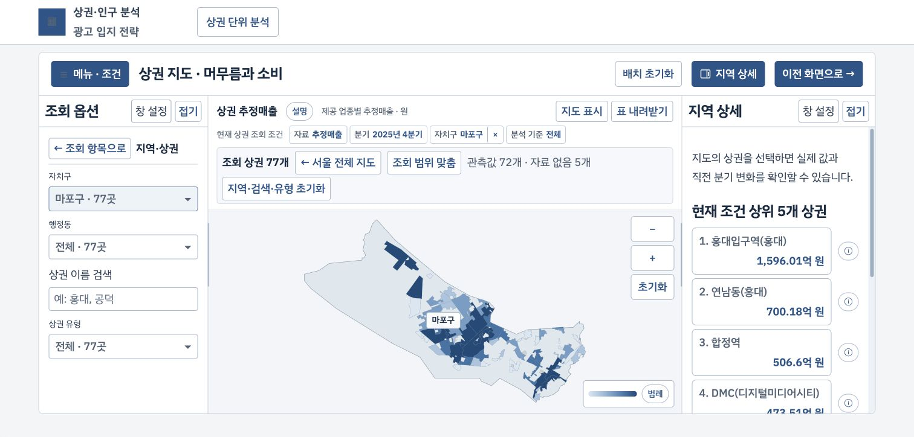

# 배포 화면 전수 방문과 후속 동작 점검

2026-11-16 · 공개 사이트: https://ilovejsbach.github.io/seoul-audience-brief/

## 점검 범위와 판정

독립 에이전트가 소스로 식별한 **52개 논리 화면·옵션 계열을 실제 Chrome 공개 화면에서 열었다.** 생활인구·생활이동·거주지 이동·추정매출의 지도/추이/후보 화면은 분석·시연 두 모드로 실행했다. 두 시점 비교는 두 모드, 저장·원본표는 분석용, 보조 분석과 상권 상세는 해당 문맥에서 실행했다.

이는 모든 날짜×지역×성별×연령×모드의 조합이나 모든 버튼을 전수 통과했다는 뜻이 아니다. [화면별 증거 목록](evidence/full-screen/coverage-results.json)은 방문·집중 점검과 미검증 항목을 구분한다. [독립 점검 계획](full-screen-coverage.md)은 실행 전 목록이므로 그 문서의 ‘실행 대기’를 소급해 통과로 바꾸지 않는다.

## 발견과 조치

|문제|변경과 확인|
|---|---|
|상권 지도 구 이름/배경을 눌러도 구 지도로 들어가지 못함|구 이름과 배경에 같은 구 탐색 동작. 마포구 실제 클릭→77개 상권·해당 경계 맞춤. 서울 전체 복귀 제공. 상권 도형 선택은 상세 확인으로 구분.|
|상권 옵션이 긴 한 창에 섞임|자료·기간 / 지역·상권 / 분석 대상의 세 상위 항목. 선택한 항목의 하위 옵션 한 개만 표시. 목록 복귀·다른 항목 이동 시 조건 유지. 분기 조건 칩→기간 편집 바로 진입.|
|범위 변경이 다른 조건까지 지울 우려|구 이동 때 자료·분기·검색·유형·대상과 후보 유지. ‘홍대’ 검색10개→발달상권4개→마포구4개→유동인구 자료4개를 실제 확인.|
|생활인구 특성 화면의 선택 시각과 지도 적용이 끊김|현재 시각을 특성 화면에 전달. 특성 비교12시→‘현재 선택일 지도에12시 적용’→지도 조건12:00 확인. 월간 평균은 당일 추계와 구분.|
|시연 후보 상세 버튼과 숫자가 같은 줄에 붙음|후보 상세 동작과 핵심 숫자를 각기 독립 행으로 배치. 두 모드4자료의 후보 열기·상세 이동 확인.|
|시연 두 시점 분포 지도 하단 잘림과 높이 부족|제목·시간 선택·색상 설정을 압축하고 지도에 잔여 높이 할당. 범례는 작은 버튼, 긴 해석은 기존 설명 툴팁으로 확인.|
|조회 옵션 너비 제어 범위 불일치|설정·실제 창 모두260–360px, 기본·초기화280px로 일치. 설정360px→실제360px 확인.|
|동별 연령 전출입을 볼 수 없는 화면에 후속 행동 부족|미제공 이유와 ‘2025년 구별 연령 지도 보기’. 서초1동→서초구 제공 조건 복구 확인. 저장 후보는 유지하되 미지원 상세 동작은 비활성+이유 표시.|
|비제공/로딩 조건에서 저장안 복원이 막힐 우려|저장은 현재 값 확보 여부로 제한하되, 이미 저장한 조건 복원은 막지 않음. 소스상 회복 경로 보호이며 이전 공개 화면에서 같은 막힘을 재현했다고 주장하지 않음.|
|이동 상대지역 제목과 일부 설명 표현|‘선택 구 이동 연계 지역’, 실제 탭 명칭 ‘생활이동’으로 정리. 상대지역 중구 클릭→중구 추이 조건 확인.|

## 실제값과 연결 점검

- 생활인구 서울 전체18시11,370,664명, 서교동20–39세남성18시32,951명/12시16,169명으로 지도·요약·그래프가 함께 바뀌는 것을 확인했다.
- 홍대입구역 추정매출4분기159,600,840,855원→그래프3분기 클릭155,933,502,839원으로 조건·상세가 변경됐다.
- 전출입30대는2025년 구별만 제공한다. 서울25구 전입308,182명·전출326,912명·순이동−18,730명이며, 1개 연도에 재생·시점비교를 가능한 것처럼 제시하지 않는다.
- 기준100 그래프는100을 중심으로89.6–110.4축과 기준선100을 표시했다. 축설정의 모든 수동입력 조합을 이번 증거로 통과 판정하지 않는다.
- 독립 검토자가 특성 평균의 차이, 인구 구성비, 두 시점 증감의 산술을 재대조했다. 화면 방문과 후속 행동의 증거 부족도 별도로 지적해 기록했다.

시연 특성 분석은 별도 검토에서 그래프가 화면 아래로 밀리는 문제를 발견했다. 입력을 한 줄, 요약 숫자를24px로 정리해 1366×768에서 그래프188px가 첫 화면 안에 보이도록 추가 조정했다. 성별 전출입의 지도 적용 버튼 줄바꿈도 줄였다.

## 검사와 배포

- 소스969bf87: 주요 연결·상권 계층 옵션 수정. Pages d6041cd, 실행43777655681 성공.
- 소스4562534: 분포 지도 공간 추가 수정. Pages7509f4e4, 실행43778857309 성공.
- 소스a9314b5: 특성 그래프·성별 적용 버튼 배치 추가 수정. Pages b3927bf38500cd494a4542e3d2713eb7f8cc9dec, 실행43779375300 성공.
- 빌드 성공, 기존 검사70개 통과. 최종 공개 배포 a9314b5의 생활인구 조회 회귀17항목을 실제1366×768/1800×905에서 각각 실행해34항목 통과. 긴 동명, 빈 검색 복구, 날짜 변경, 중복 입력·가로 넘침도 포함한다.
- before는기존 공개화면, after는위 수정체크포인트의 공개화면이다. 마지막 스타일 변경의 재확인 증거는 별도 최신 파일로 연결한다. 원자료는 변경하지 않았다.

## 남은 검증 한계

CSV 버튼 클릭은 실행했으나 브라우저 자동화의 다운로드 이벤트가 응답하지 않아 저장 파일·내용은 확인하지 못했다. 내부 다운로드 페이지 접근도 브라우저 정책으로 차단되어 우회하지 않았다. 따라서 이 항목은 통과가 아닌 **파일 검증 미완료**다.

네이티브 전체화면의 모든 운영체제 조합, 저장안3개상한·모든 삭제, 전체 데이터 조합과 모든 옵션값은 이번 방문 증거의 범위를 벗어난다. 실제 실행한 후속 행동은 [별도 기록](evidence/full-screen/after/observed-followup-actions.json)에 명시했다.

최종 공개 재확인: 1366×768의 분포 지도385.4px, 특성 그래프188px이며 두 그래프 모두 화면 안에 들어온다. 성별 지도 적용 버튼은126×39px의 한 줄이다. 최종 상권 지도는 구 배경 키보드 선택→마포구77곳·하위 편집1개 표시를 재확인했다. 이전체크포인트의 구 이름 실제마우스클릭 증거와 구분한다.

